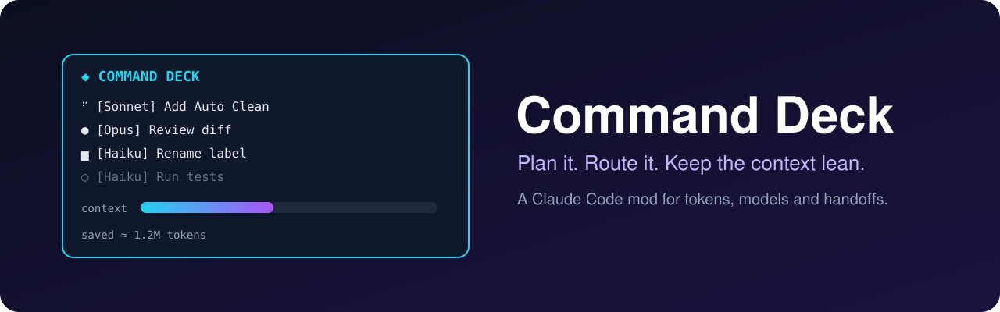
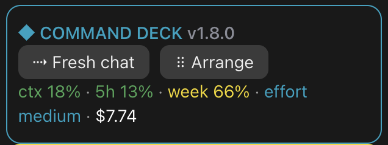
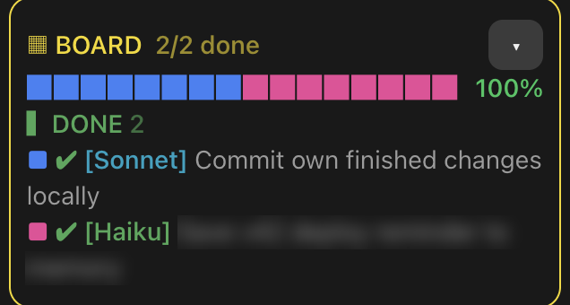
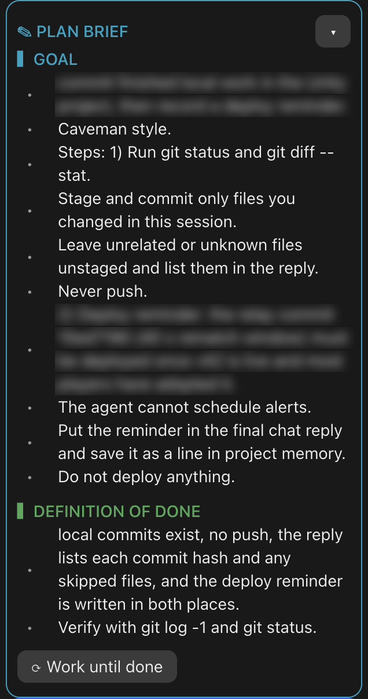
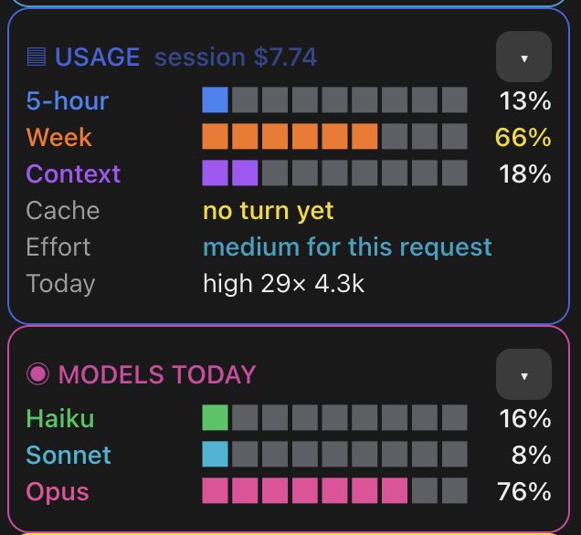
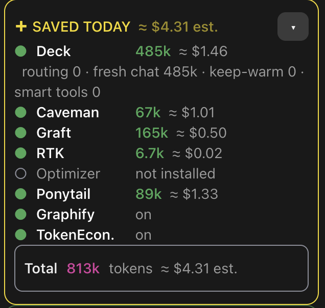
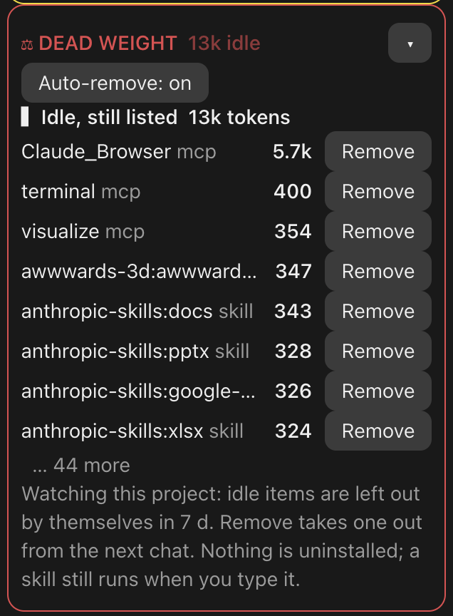
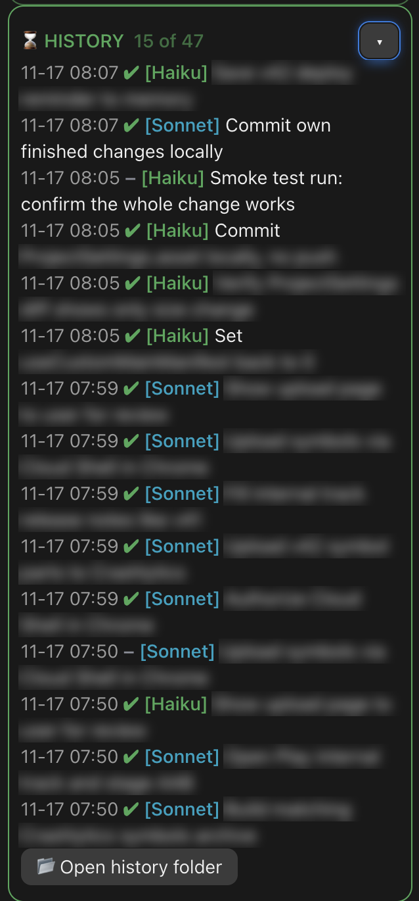

<p align="center"></p>

# Command Deck

A Claude Code mod that plans work, sends each task to the cheapest model that can do it, and keeps a live board of usage, git state and handoffs.

Needs Claude Code 2.1.280 or later (mods, `CLAUDE_CODE_PLUGIN_DIRS`). MIT licensed.

## Why I built this

I used to chase every last token, and I kept accidentally using far too many. The routine had too many chores to remember:

- run `/compact` or `/clear`
- run the cleanup and skills passes
- switch to a cheaper model for easy tasks
- keep the prompt cache warm

I would forget one, and context piled up. I often had no idea how full it was, and the numbers were spread over different tabs. Each habit also had extra steps I could skip.

Command Deck puts it in one pane you can read at a glance:

- context fill, daily token use and estimated savings
- a plan with each step tagged Haiku, Sonnet or Opus
- caveman replies, clean code rules and auto-plan, always on
- a Fresh chat button: writes a handoff, then clears the chat
- a warning before the cache goes cold, and a keep-warm ping

It is my one-shot attempt to put most of what I know about saving tokens and cost into one tool, so nobody has to remember the routine. Feedback and fixes are welcome.

## Features

- **Auto-plan.** Each message is checked. Big or vague ones are split into small steps, each tagged Haiku, Sonnet or Opus. Parallel steps are marked `∥`.
- **Kanban board.** Tasks, status, tokens per task, a history of the last 200 finished tasks that survives `/clear`.
- **Usage and git panel.** Context bar, daily usage, branch, ahead/behind, changed files.
- **Clean code toggle.** Engineering rules added to every chat. Step-specific rules (bug, feature, refactor, design, perf, security, risky, test) are picked per task and model by plain keywords, with one final review pass at the end. No extra model call.
- **Effort routing.** The planner also says how hard each request needs the model to think, and the deck sends that level with the turn: a rename runs at low, a hard bug at your own level. Nothing is added to the prompt and no skill is loaded. Some models pay for their whole cache again when the level changes: the deck watches the requests it sends at a changed level, and after two that were paid for again it leaves that model family alone. Until a family is proven, the level only changes while the context is under 80k tokens, so finding out has a bounded cost.
- **Caveman mode.** Short, blunt replies to save output tokens, on in every chat. The rules are part of the deck, so no skill has to be installed or loaded; every typed message carries a one-line reminder (about 20 tokens), because a rule that sits once in the system prompt fades in a long chat. Saying "normal mode" turns it off for the chat.
- **Graft first.** In a repo Graft has indexed, the deck tells the model to search with Graft, counts Graft's CLI answers as well as its MCP ones, never moves it behind tool search, and adds one short reminder after a plain grep in a turn where Graft sat unused.
- **Verify gate.** Put your test or build command in `.claude/deck/verify.txt` (or run `/command-deck verify <command>`). After every turn that changes files the deck runs it in the background. A pass costs no tokens; a failure goes back to the model with the end of the output, twice at most per message, so "done" means passing. A command that came from a project file is never run until you allow that exact text in the pane.
- **Fresh-eyes review.** A plan that is big (5 steps or more), hard (an Opus step) or touches something costly to get wrong (auth, deletes, migrations, payments) gets a step where a Sonnet subagent with no history reads only the diff and hunts bugs.
- **Plan review.** The same kind of risky plan starts with a step where a subagent reads the brief and the steps before any code is written.
- **Rules at edit time.** The first edit of a file type gives the model that type's rules once, plan or no plan: your own `.claude/deck/rules-<ext>.md` (for example `rules-ts.md`), and the Unity rules for a script in a Unity project.
- **Guards.** `.claude/deck/guards.md` holds one `pattern => reason` per line, for example `git push*--force => Ask first`. The pattern is plain text, with `*` for anything in between, matched without case (never a regular expression). A shell command it matches is refused, and the model reads the reason. A guard can only refuse.
- **Stuck detector.** The same call failing the same way three times in a row earns one line telling the model to stop and change approach.
- **Project notes in every chat.** A new chat starts with the newest lasting facts and `.claude/deck/conventions.md` (`/command-deck conventions` has the model scan the project and write it).
- **Save as rule.** When a typed message reads like a correction, the pane offers "Save as rule". That drafts a one-line rule and shows it; "Keep" writes exactly that text to `.claude/deck/conventions.md`. Nothing is kept without both presses.
- **Unity.** The Unity rules are a core plus topic packs (UI, performance, tweens, hierarchy, game doc) picked by the words of the step, so a small fix pays for about half of them. A subagent that touches C# gets them in its own prompt from the deck, not pasted by the main chat. With the Unity MCP connected, a C# edit is refused while the editor is in Play mode. After a C# edit the deck asks the editor to refresh, waits until it is idle, then sends any compile errors back to the model. "Clean" shows only for a compile the deck asked for and saw finish. A C# plan's smoke card asks for a clean compile and passing EditMode tests.
- **Unity rule lines.** Short rules for pinning the editor version, reading a scene or prefab value back after writing it, and ending gameplay work with an exact Play check.
- **Project memory.** Each handoff also gathers up to three lasting facts (a command that works, a trap, a decision) into `.claude/deck/memory.md`, and every later handoff carries them.
- **Handoff memory.** Writes a handoff note and starts a fresh chat at a context % you choose, or on a new topic.
- **Cache guard and keep-warm.** Warns before an expensive cold-cache rewrite and can ping to keep the cache warm.
- **Smart tool deferral.** Moves MCP servers the work does not need behind tool search.
- **Savings counter.** Estimated tokens and dollars saved per tool (Graft, Caveman, Optimizer, RTK, Ponytail, Graphify). Every tool keeps its row and a plain state: ● on, ◐ installed but not running, ○ not installed.
- **Carry on.** A big task often stops after a step with the next one plain to see. When a turn ends with open cards, Haiku reads the answer: if nothing waits on you, the deck sends the next step itself (at most `autoContinueMax` for one message you typed). It stops for a question, a blocker, anything that goes live or cannot be undone, save mode, or two steps that closed no card. Each answer is kept in `.claude/deck/run-<time>.md`, and the run ends with one final report: done, checked, not checked, needs you, left.
- **Planner knows you.** The planner reads your deck rules, project memory, `CLAUDE.md` files and Claude's memory index, so it plans with the tools and habits you already named. A message that states a habit ("I always use X for Y") gets the same "Save as rule" offer as a correction.
- **Work until done.** When the plan brief says when the work is done, the Plan brief section shows a "Work until done" button. The button hands that line to Claude Code's own `/goal`.
- **Compaction.** When the chat is compacted, the summary is told to keep the goal, rules, decisions and open tasks. File-type rules are given again on the next edit.
- **Dead weight.** The deck notes when each skill and MCP server was last called in this project. One that nothing called for 7 days is left out when a chat starts: the skill's line leaves the listing the model reads, the server's tools go behind search. Nothing is uninstalled, a skill still runs when you type it, and a call, or naming it in the chat's first message, brings it back. Nothing is left out before the project was watched for those 7 days. The Dead weight section shows what this chat left out and what sits idle, with Put back and Remove on each row and one Auto-remove switch. A press changes the next chat, not the running one, so the prompt cache holds.
- **Version in the header.** The pane header shows the running version in gray.

### The pane

The header holds Fresh chat and Arrange, and one line that reads at a glance: context, limits, cache, effort and cost. Arrange shows the move buttons on every section (and Reset); otherwise a section header holds only its fold button. Minimized, the pane shrinks to that glance line, the board bar and the running card.

A bar is a row of cells. Each cell is a box the layout sizes, holding one block glyph, so a bar is always one line and always spans its full width, at any window size and in any font. The pane's column count only decides how many cells a bar has. Every meter has its own colour (5-hour, Week, Context, and each model); for a limit, the percent turns yellow, then red, as it nears the top.

<p align="center"></p>

The board follows the plan, every subagent and the chat's own task list. Each subagent gets a card (the step its description names, or a new one) that is DOING while it runs and DONE when it returns. The main chat closes a card with `TodoWrite` or `TaskUpdate`, or, where it has no task tools, with a `Done: <title>` line in its reply (`Todo: <title>` adds one, `Skip: <title>` closes one dropped on purpose as skipped, shown grey in DONE). A plan that changes no code (release notes, research) gets no smoke test card. DOING means work is live: a card the main chat only touched goes back to TODO when its turn ends. When an answer leaves cards in TODO without those lines, a small Haiku call reads the answer and closes the ones it says are done or dropped; cards it is unsure of stay open.

Above the lanes a bar shows the whole board: one colored stretch per card, in the same color as the mark on that card's row. Done is solid, the running stretch shimmers (a highlight sweeps across it; held lit with `reducedMotion`), a failed card is red, skipped cards are left out, and the percent warms from red to green.

<p align="center"></p>

The Plan brief section shows the brief the planner wrote for the request: the goal, and when the work counts as done.

<p align="center"></p>

Usage shows the 5-hour and weekly limits, the context bar and the cache state. `contextBreakdown` splits the context bar by what fills it. Models today has a row for Haiku, Sonnet and Opus, and for Fable once it has tokens.

<p align="center"></p>

The savings counter estimates what Graft, the optimizer, Graphify, Ponytail, caveman mode and Command Deck itself kept out of the context. The Deck row is Command Deck's own part (routing, fresh chats, keep-warm, smart tools). The last row is the total of every row above, an educated guess like the rows it adds up.

<p align="center"></p>

Dead weight lists the skills and MCP servers nothing has called, with what each costs in every chat.

<p align="center"></p>

History keeps finished cards across chats.

<p align="center"></p>

## Install

Pick one.

### 1. From the marketplace (recommended)

Run these in a terminal. The desktop app's plugin search and Code tab are not the install path.

```bash
claude plugin marketplace add nixonok/command-deck
claude plugin install command-deck@command-deck-market
claude plugin list
```

Update later with `claude plugin marketplace update command-deck-market`, then restart Claude. If that says the marketplace is not found, run the `marketplace add` line above first.

### 2. From git, no marketplace

Download the repository from https://github.com/nixonok/command-deck (a zip or a clone) into `~/command-deck`.

Load it for one session:

```bash
claude --plugin-dir ~/command-deck
```

Or load it every time. Add to `~/.claude/settings.json` (absolute path or `~/...`; separate several folders with `:` on macOS and Linux, `;` on Windows):

```json
{ "env": { "CLAUDE_CODE_PLUGIN_DIRS": "~/command-deck" } }
```

After any install, run `/reload-plugins` (or start a new chat). The pane opens by itself, or open it with `/command-deck`.

## Use

| Command | What it does |
|---|---|
| `/command-deck` | Open the board |
| `/command-deck-plan <what you want>` | Sharpen a request, ask what is unclear, split it into tasks per model |
| `/command-deck run` | Run the open tasks, each on its own model |
| `/command-deck fresh` | Handoff, then a new chat |
| `/command-deck verify [command]` | Set the verify command (and allow it) · with no command, run the check now |
| `/command-deck conventions` | Have the model scan the project and write `.claude/deck/conventions.md` |
| `/command-deck handoff` · `compact` | Write a handoff note · compact the chat |
| `/command-deck done N` · `clear` | Mark task N done · clear the board |
| `/command-deck warm [on\|off] [hours]` | Keep the prompt cache warm |
| `/command-deck tools [on\|off]` | Smart MCP tool deferral |

Clean code rules and auto-plan are always on. Caveman and effort routing are on by default (`caveman`, `autoEffort`). To pick the effort for one message yourself, say it in the message: `effort: high`, or `max effort`. The pane header has Fresh chat (writes a handoff, then clears the chat) and Arrange.

## How clean code picks rules

1. A short core (about 150 words) goes into the system prompt once. Cheap to keep, covered by the prompt cache.
2. For each plan step, keywords in the title choose up to 2 extra sections for a Sonnet step, up to 4 for Opus, none for Haiku. A rename gets core only. A "design the module layout" step gets the design rules.
3. A plan with more than one step ends with one final review of the whole diff. It never runs per step.
4. Each plan appends its picks to `.claude/deck/rules-log.md` so you can see what was chosen.


## Settings and thresholds

Every option is a `userConfig` entry with a default in `.claude-plugin/plugin.json`.

Change a value in any of these ways:

- Ask Claude: *"set Command Deck autoFreshPct to 60"* (it edits the setting for you).
- In a session: `/plugin configure command-deck`.
- Shell: `claude plugin configure command-deck`, or on install `claude plugin install command-deck --config autoFreshPct=60`.

| Option | Default | Meaning |
|---|---|---|
| `autoFreshPct` | 50 | Past this context %, your next message writes a handoff, clears the chat and goes to the fresh chat. Never mid-turn. 0 is off. |
| `autoCompactPct` | 0 | Compact at this context % when handoff is off. |
| `autoFresh` | 1 | Move to a new chat when a long chat starts a new topic. |
| `handoffTurns` | 12 | Suggest a handoff after this many prompts. |
| `plannerChatMessages` | 5 | Latest chat messages the planner reads. 0 sends none. |
| `plannerChatChars` | 500 | Characters kept per message sent to the planner. |
| `judgeBoard` | 1 | After each answer, Haiku closes the TODO cards the answer settles, drops the cards of a plan the answer did not follow, and adds up to 3 cards for work the answer says is left. 0 is off. |
| `autoStart` | 1 | Open the pane in every new chat. |
| `caveman` | 1 | Short blunt replies in every chat. 0 is off. |
| `autoEffort` | 1 | Effort routing: 0 off, 1 only lowers (never above your own `/effort` level), 2 may also raise. |
| `contextBreakdown` | 0 | 1 splits the Context bar by what fills it and lists the parts. |
| `verifyGate` | 1 | Run the project's check after a turn that changes files. 0 is off. |
| `freshReview` | 1 | Add the fresh-eyes review step to risky plans. 0 is off. |
| `planReview` | 1 | Add a plan review step (a subagent reads the brief and steps before any code) to risky plans. 0 is off. |
| `briefReports` | 1 | Ask every subagent for a tight final report. 0 is off. |
| `unityPlayGuard` | 1 | Refuse a C# edit while the Unity editor is in Play mode. 0 is off. |
| `learnRules` | 1 | Offer "Save as rule" when a typed message reads like a correction or states a habit. 0 is off. |
| `autoContinue` | 1 | Send the next step by itself when a turn ends with open cards and nothing waits on you. 0 is off. |
| `autoContinueMax` | 8 | Most automatic steps for one message you typed. |
| `deadWeightPrune` | 1 | Leave idle skills and MCP servers out of new chats by itself. 0 only lists them; what you remove by hand is still left out. |
| `deadWeightDays` | 7 | Days a skill or MCP server must go uncalled in this project to count as dead weight. Also how long a project is watched before anything is left out. |
| `saveModePct` | 80 | Past this percent of the 5-hour or weekly limit, effort routing sends nothing above medium. 0 is off. |
| `reducedMotion` | 0 | 1 holds the Doing-card bots still (terminals have no reduced-motion setting). |
| `coldGuard` | 1 | 0 off, 1 warn, 2 also hold the first send. |
| `cacheTtlMin` | 60 | Prompt cache lifetime. Use 5 for API-key billing. |
| `coldMinTokens` | 50000 | Below this context size the guard does nothing. |
| `autoKeepWarm` · `warmPingMin` · `warmHours` | 1 · 50 · 6 | Keep-warm switch, idle minutes before a ping, and how long it stays on. |
| `smartTools` | 1 | Defer unneeded MCP servers. |
| `cavemanRatio` · `routingSaveRatio` · `optimizerTokensPerCall` | 0.35 · 0.67 · 1200 | Assumptions behind the savings estimate. |
| `ponytailRatio` · `graphifyTokensPerCall` | 0.45 · 1200 | Same for Ponytail (output tokens spared) and Graphify (per query, path or explain). |
| `inputDollarsPerMTok` · `outputDollarsPerMTok` | 3 · 15 | Prices for the dollar figure. |

## Edit the mod

Source is plain TypeScript. Edit, then `/reload-plugins`.

| File | Holds |
|---|---|
| `hooks/register.tsx` | Commands, hooks, the pane and its buttons |
| `hooks/lib.ts` | Pure logic: planner prompt, handoff text, defaults, tips |
| `hooks/guidelines.ts` | Clean code core, tagged sections and the keyword picker |
| `hooks/deck.test.ts` | Tests |
| `.claude-plugin/plugin.json` | Name, version, settings |

To change the clean code rules, edit `CORE` and `SECTIONS` in `hooks/guidelines.ts`. A section is an id, a keyword regex, the lowest model tier that gets it, and its text.

Or just ask Claude: *"in the command-deck folder, add a database section to guidelines.ts"*. Then check your work:

```bash
claude plugin test .
claude plugin validate .
```

## Files it writes

Only under `.claude/deck/` in your project: `rules.md` (your rules for new chats, edit freely), `memory.md` (lasting facts gathered at handoffs, edit freely), `verify.txt` (when you run `/command-deck verify <command>`, or write it yourself), handoffs, progress notes and `rules-log.md`. It reads, and never writes, `guards.md` and `rules-<ext>.md` there. `conventions.md` is written only by `/command-deck conventions` or when you press Save as rule. Nothing leaves your machine except the model calls Claude Code already makes.

## Optional tools

Every savings row shows its tool's state. Graft and token-optimizer count as installed when their MCP servers are connected (the Graft skill without its server reads Not Active). Graft also counts as on in any repo that has its index (`graft/INDEX.md`), since its CLI works without the server. Caveman is part of the deck and needs nothing installed. Ponytail and Graphify count as installed when the chat lists their skills (or the Graphify MCP server); Their figures are estimates. RTK's row comes from `rtk gain` (today's saved tokens) and `rtk verify` (Not Active when its Claude Code hook is not registered).

The Unity checks (Play mode guard and compile gate) need a Unity MCP whose tools are named `mcp__unity__unity_editor_state`, `mcp__unity__unity_get_compilation_errors` and `mcp__unity__unity_execute_menu_item`. With another Unity MCP these checks stay off.

The board follows the chat's own task list: new tasks from `TodoWrite` or `TaskCreate` (or `Todo:` lines in a reply) become cards, and a card moves to Doing or Done when its task is started or completed (or a `Done:` line names it; a `Skip:` line closes it as skipped). Every subagent shows as its own card.

## What the mod does (for reviewers)

Command Deck is a mod, so it uses powers a plain skill does not. Each one, and why:

- **Writes files.** Only under `.claude/deck/` in the project (rules, memory, handoffs, progress notes, history, tip files, and `conventions.md` when you run `/command-deck conventions` or keep a rule from a correction). The paths are fixed text in `hooks/register.tsx`. It never edits build, start-up, settings or instruction files.
- **Starts programs.** Your verify command, through `/bin/sh -c`, after a turn that changed files: only the first line of `.claude/deck/verify.txt`, and only once you allowed that exact text for that project (the allowance is kept outside the repo, so a cloned project cannot run anything). `git` (status and refs for the git panel), `rtk` (`gain` and `verify`, only to show the RTK savings row; absent means the row says Not Installed), and `open` / `xdg-open` / `explorer` to show the `.claude/deck/` folder. Apart from the verify command, each command is fixed text; nothing from the chat is run as a command.
- **Reads the conversation, sends nothing out.** It reads chat and usage data to fill the board and savings. It sends no data to any server of its own; the only model calls are the ones Claude Code makes (including the Haiku agents below).
- **Starts agents.** The planner and the board judge run as Haiku agents. They get the user's request, up to `plannerChatMessages` recent messages (each cut to `plannerChatChars` characters) and the task titles. The planner also gets your deck rules, project memory and the instruction and memory files the chat itself loaded (cut to 14,000 characters). The carry-on judge gets the last answer and the open card titles.
- **Submits prompts.** The plan, a handoff, a new-topic message, a failed verify check, a carry-on step and the final report request are submitted into the chat as the user's own prompt, so the user sees them. Nothing is hidden.
- **Runs `/clear`.** Fresh chat and the new-topic move write a handoff file first and then clear the chat. The new-topic move can be turned off in the plugin options (`autoFresh`); the threshold is `autoFreshPct`.
- **Changes the turn's effort.** With `autoEffort` on, the `turn.step` hook sends the main chat's requests at the level the planner picked (never above your own level unless `autoEffort` is 2). It never changes the main chat's model.
- **Adds a reminder after a tool result.** In a Graft-indexed repo, at most one line per turn and three per chat, after a plain grep.
- **Refuses tool calls.** A shell command matching a line of the project's `guards.md`, and a C# edit while the Unity editor plays. Nothing else is refused.
- **Calls tools itself.** Unity MCP tools, only in a Unity project: two read-only ones (`unity_editor_state`, `unity_get_compilation_errors`) to check Play mode and compile errors, and `unity_execute_menu_item` to ask the editor to refresh after a C# edit.
- **Rewrites subagent prompts.** It appends a line asking for a tight report, and the Unity rules for a subagent that touches C#. Forks, teammates and workflow agents are left as written.
- **Changes agent model.** The `agent.spawn` hook sets `model: haiku` on Explore agents and on agents for a Haiku-tier board card. It does not change permission modes, and it passes every other event on unchanged.
- **Credentials.** It reads no keys or tokens. The only local reads are the project's `.claude/deck/` files and the tool output above.
- **Install help.** The Install buttons in the savings pane only submit a prompt that names each tool, its source link and its steps. They run nothing themselves.

## Versioning

Semantic versioning. The version lives in `.claude-plugin/plugin.json`. Bump it on every release. A user only receives an update when the version changes.

## Publishing (maintainers)

See [PUBLISHING.md](PUBLISHING.md).

## Feedback and contributing

Command Deck was built in one sitting, so there are rough edges. Feedback, corrections, additions and improvements are welcome. Anyone can open an issue or send a pull request.

- Found a bug or have an idea: [open an issue](https://github.com/nixonok/command-deck/issues/new/choose).
- Want to change the code: read [CONTRIBUTING.md](CONTRIBUTING.md). It covers the steps and the two checks every pull request must pass (`claude plugin test .` and `claude plugin validate . --strict`).
- Every pull request is reviewed by the maintainer before merging.

## License

MIT. See [LICENSE](LICENSE).
