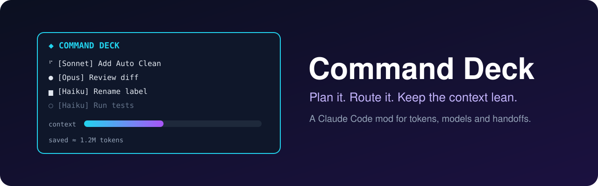
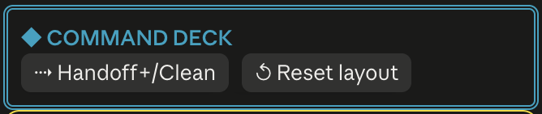
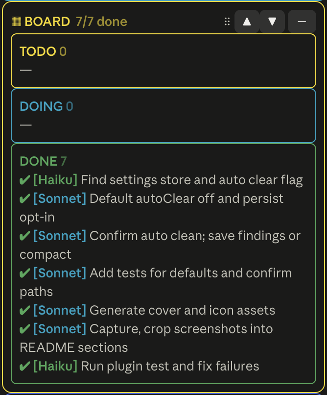
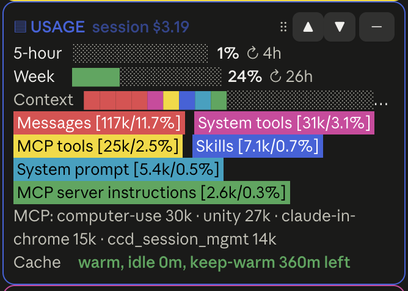
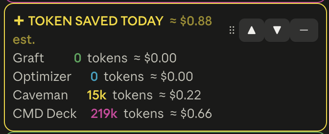

<p align="center"></p>

# Command Deck

A Claude Code mod that plans work, sends each task to the cheapest model that can do it, and keeps a live board of usage, git state and handoffs.

Needs Claude Code 2.1.280 or later (mods, `CLAUDE_CODE_PLUGIN_DIRS`). MIT licensed.

## Why I built this

I used to chase every last token, and I kept accidentally using far too many. The routine had too many chores to remember:

- run `/compact` or `/clear`
- run the cleanup and skills passes
- switch to a cheaper model for easy tasks
- keep the prompt cache warm

I would forget one, and context piled up. I often had no idea how full it was, and the numbers were spread over different tabs. Each habit also had extra steps I could skip.

Command Deck puts it in one pane you can read at a glance:

- context fill, daily token use and estimated savings
- a plan with each step tagged Haiku, Sonnet or Opus
- caveman replies, clean code rules and auto-plan, always on
- a Handoff+/Clean button: writes a handoff, then clears the chat
- a warning before the cache goes cold, and a keep-warm ping

It is my one-shot attempt to put most of what I know about saving tokens and cost into one tool, so nobody has to remember the routine. Feedback and fixes are welcome.

## Features

- **Auto-plan.** Each message is checked. Big or vague ones are split into small steps, each tagged Haiku, Sonnet or Opus. Parallel steps are marked `∥`.
- **Kanban board.** Tasks, status, tokens per task, a history of the last 200 finished tasks that survives `/clear`.
- **Usage and git panel.** Context bar, daily usage, branch, ahead/behind, changed files.
- **Clean code toggle.** Engineering rules added to every chat. Step-specific rules (bug, feature, refactor, design, perf, security, risky, test) are picked per task and model by plain keywords, with one final review pass at the end. No extra model call.
- **Caveman mode.** Short, blunt replies to save output tokens, on in every chat.
- **Handoff memory.** Writes a handoff note and starts a fresh chat at a context % you choose, or on a new topic.
- **Cache guard and keep-warm.** Warns before an expensive cold-cache rewrite and can ping to keep the cache warm.
- **Smart tool deferral.** Moves MCP servers the work does not need behind tool search.
- **Savings counter.** Estimated tokens and dollars saved per tool (Graft, Caveman, Optimizer, RTK, Ponytail, Graphify). A tool that is not installed says (Not Installed); one installed but off says (Not Active).

### The pane

The header holds Handoff+/Clean and Reset layout. Caveman, clean code and auto-plan are always on.

<p align="center"></p>

The board follows the plan, every subagent and the chat's own task list. Each subagent gets a card (the step its description names, or a new one) that is DOING while it runs and DONE when it returns. The main chat closes a card with `TodoWrite` or `TaskUpdate`, or, where it has no task tools, with a `Done: <title>` line in its reply (`Todo: <title>` adds one, `Skip: <title>` closes one dropped on purpose as skipped, shown grey in DONE). A plan that changes no code (release notes, research) gets no smoke test card. DOING means work is live: a card the main chat only touched goes back to TODO when its turn ends. When an answer leaves cards in TODO without those lines, a small Haiku call reads the answer and closes the ones it says are done or dropped; cards it is unsure of stay open.

Above the lanes a bar shows the whole board: one colored stretch per card, in the same color as the mark on that card's row. Done is solid, the running stretch blinks (held lit with `reducedMotion`), a failed card is red, skipped cards are left out, and the percent warms from red to green.

<p align="center"></p>

Usage shows the 5-hour and weekly limits, a context bar split by what fills it, and the cache state.

<p align="center"></p>

The savings counter estimates what Graft, the optimizer, Graphify, Ponytail, caveman mode and Command Deck itself kept out of the context. The last row, under a line, is the CMD Deck total: Command Deck's own savings plus every tool above, an educated guess like the rows it adds up.

<p align="center"></p>

## Install

Pick one.

### 1. From the marketplace (recommended)

Run these in a terminal. The desktop app's plugin search and Code tab are not the install path.

```bash
claude plugin marketplace add nixonok/command-deck
claude plugin install command-deck@command-deck-market
claude plugin list
```

Update later with `claude plugin marketplace update command-deck-market`, then restart Claude. If that says the marketplace is not found, run the `marketplace add` line above first.

### 2. From git, no marketplace

Download the repository from https://github.com/nixonok/command-deck (a zip or a clone) into `~/command-deck`.

Load it for one session:

```bash
claude --plugin-dir ~/command-deck
```

Or load it every time. Add to `~/.claude/settings.json` (absolute path or `~/...`; separate several folders with `:` on macOS and Linux, `;` on Windows):

```json
{ "env": { "CLAUDE_CODE_PLUGIN_DIRS": "~/command-deck" } }
```

After any install, run `/reload-plugins` (or start a new chat). The pane opens by itself, or open it with `/command-deck`.

## Use

| Command | What it does |
|---|---|
| `/command-deck` | Open the board |
| `/command-deck-plan <what you want>` | Sharpen a request, ask what is unclear, split it into tasks per model |
| `/command-deck run` | Run the open tasks, each on its own model |
| `/command-deck fresh` | Handoff, then a new chat |
| `/command-deck handoff` · `compact` | Write a handoff note · compact the chat |
| `/command-deck done N` · `clear` | Mark task N done · clear the board |
| `/command-deck warm [on\|off] [hours]` | Keep the prompt cache warm |
| `/command-deck tools [on\|off]` | Smart MCP tool deferral |

Caveman mode, clean code rules and auto-plan are always on; there is no switch for them. The pane header has Handoff+/Clean (writes a handoff, then clears the chat) and Reset layout.

## How clean code picks rules

1. A short core (about 150 words) goes into the system prompt once. Cheap to keep, covered by the prompt cache.
2. For each plan step, keywords in the title choose up to 2 extra sections for a Sonnet step, up to 4 for Opus, none for Haiku. A rename gets core only. A "design the module layout" step gets the design rules.
3. A plan with more than one step ends with one final review of the whole diff. It never runs per step.
4. Each plan appends its picks to `.claude/deck/rules-log.md` so you can see what was chosen.


## Settings and thresholds

Every option is a `userConfig` entry with a default in `.claude-plugin/plugin.json`.

Change a value in any of these ways:

- Ask Claude: *"set Command Deck autoFreshPct to 60"* (it edits the setting for you).
- In a session: `/plugin configure command-deck`.
- Shell: `claude plugin configure command-deck`, or on install `claude plugin install command-deck --config autoFreshPct=60`.

| Option | Default | Meaning |
|---|---|---|
| `autoFreshPct` | 50 | Past this context %, your next message writes a handoff, clears the chat and goes to the fresh chat. Never mid-turn. 0 is off. |
| `autoCompactPct` | 0 | Compact at this context % when handoff is off. |
| `autoFresh` | 1 | Move to a new chat when a long chat starts a new topic. |
| `handoffTurns` | 12 | Suggest a handoff after this many prompts. |
| `plannerChatMessages` | 8 | Latest chat messages the planner reads. 0 sends none. |
| `plannerChatChars` | 500 | Characters kept per message sent to the planner. |
| `judgeBoard` | 1 | After each answer, Haiku closes the TODO cards the answer settles. 0 is off. |
| `autoStart` | 1 | Open the pane in every new chat. |
| `reducedMotion` | 0 | 1 holds the Doing-card bots still (terminals have no reduced-motion setting). |
| `coldGuard` | 1 | 0 off, 1 warn, 2 also hold the first send. |
| `cacheTtlMin` | 60 | Prompt cache lifetime. Use 5 for API-key billing. |
| `coldMinTokens` | 50000 | Below this context size the guard does nothing. |
| `autoKeepWarm` · `warmPingMin` · `warmHours` | 1 · 50 · 6 | Keep-warm switch, idle minutes before a ping, and how long it stays on. |
| `smartTools` | 1 | Defer unneeded MCP servers. |
| `cavemanRatio` · `routingSaveRatio` · `optimizerTokensPerCall` | 0.35 · 0.67 · 1200 | Assumptions behind the savings estimate. |
| `ponytailRatio` · `graphifyTokensPerCall` | 0.45 · 1200 | Same for Ponytail (output tokens spared) and Graphify (per query, path or explain). |
| `inputDollarsPerMTok` · `outputDollarsPerMTok` | 3 · 15 | Prices for the dollar figure. |

## Edit the mod

Source is plain TypeScript. Edit, then `/reload-plugins`.

| File | Holds |
|---|---|
| `hooks/register.tsx` | Commands, hooks, the pane and its buttons |
| `hooks/lib.ts` | Pure logic: planner prompt, handoff text, defaults, tips |
| `hooks/guidelines.ts` | Clean code core, tagged sections and the keyword picker |
| `hooks/deck.test.ts` | Tests |
| `.claude-plugin/plugin.json` | Name, version, settings |

To change the clean code rules, edit `CORE` and `SECTIONS` in `hooks/guidelines.ts`. A section is an id, a keyword regex, the lowest model tier that gets it, and its text.

Or just ask Claude: *"in the command-deck folder, add a database section to guidelines.ts"*. Then check your work:

```bash
claude plugin test .
claude plugin validate .
```

## Files it writes

Only under `.claude/deck/` in your project: `rules.md` (your rules for new chats, edit freely), handoffs, progress notes and `rules-log.md`. Nothing leaves your machine except the model calls Claude Code already makes.

## Optional tools

Every savings row shows its tool's state. Graft and token-optimizer count as installed when their MCP servers are connected (the Graft skill without its server reads Not Active). Caveman, Ponytail and Graphify count as installed when the chat lists their skills (or the Graphify MCP server); Their figures are estimates. RTK's row comes from `rtk gain` (today's saved tokens) and `rtk verify` (Not Active when its Claude Code hook is not registered).

The board follows the chat's own task list: new tasks from `TodoWrite` or `TaskCreate` (or `Todo:` lines in a reply) become cards, and a card moves to Doing or Done when its task is started or completed (or a `Done:` line names it; a `Skip:` line closes it as skipped). Every subagent shows as its own card.

## What the mod does (for reviewers)

Command Deck is a mod, so it uses powers a plain skill does not. Each one, and why:

- **Writes files.** Only under `.claude/deck/` in the project (rules, handoffs, progress notes, history, tip files). The paths are fixed text in `hooks/register.tsx`. It never edits build, start-up, settings or instruction files.
- **Starts programs.** `git` (status and refs for the git panel), `rtk` (`gain` and `verify`, only to show the RTK savings row; absent means the row says Not Installed), and `open` / `xdg-open` / `explorer` to show the `.claude/deck/` folder. Each command is fixed text; nothing from the chat is run as a command.
- **Reads the conversation, sends nothing out.** It reads chat and usage data to fill the board and savings. It sends no data to any server of its own; the only model calls are the ones Claude Code makes (including the Haiku agents below).
- **Starts agents.** The planner and the board judge run as Haiku agents. They get the user's request, up to `plannerChatMessages` recent messages (each cut to `plannerChatChars` characters) and the task titles.
- **Submits prompts.** The plan, a handoff and a new-topic message are submitted into the chat as the user's own prompt, so the user sees them. Nothing is hidden.
- **Runs `/clear`.** Handoff+/Clean and the new-topic move write a handoff file first and then clear the chat. The new-topic move can be turned off in the plugin options (`autoFresh`); the threshold is `autoFreshPct`.
- **Changes agent model.** The `agent.spawn` hook sets `model: haiku` on Explore agents and on agents for a Haiku-tier board card. It does not change permission modes, and it passes every other event on unchanged.
- **Credentials.** It reads no keys or tokens. The only local reads are the project's `.claude/deck/` files and the tool output above.
- **Install help.** The Install buttons in the savings pane only submit a prompt that names each tool, its source link and its steps. They run nothing themselves.

## Versioning

Semantic versioning. The version lives in `.claude-plugin/plugin.json`. Bump it on every release. A user only receives an update when the version changes.

## Publishing (maintainers)

See [PUBLISHING.md](PUBLISHING.md).

## Feedback and contributing

Command Deck was built in one sitting, so there are rough edges. Feedback, corrections, additions and improvements are welcome. Anyone can open an issue or send a pull request.

- Found a bug or have an idea: [open an issue](https://github.com/nixonok/command-deck/issues/new/choose).
- Want to change the code: read [CONTRIBUTING.md](CONTRIBUTING.md). It covers the steps and the two checks every pull request must pass (`claude plugin test .` and `claude plugin validate . --strict`).
- Every pull request is reviewed by the maintainer before merging.

## License

MIT. See [LICENSE](LICENSE).
